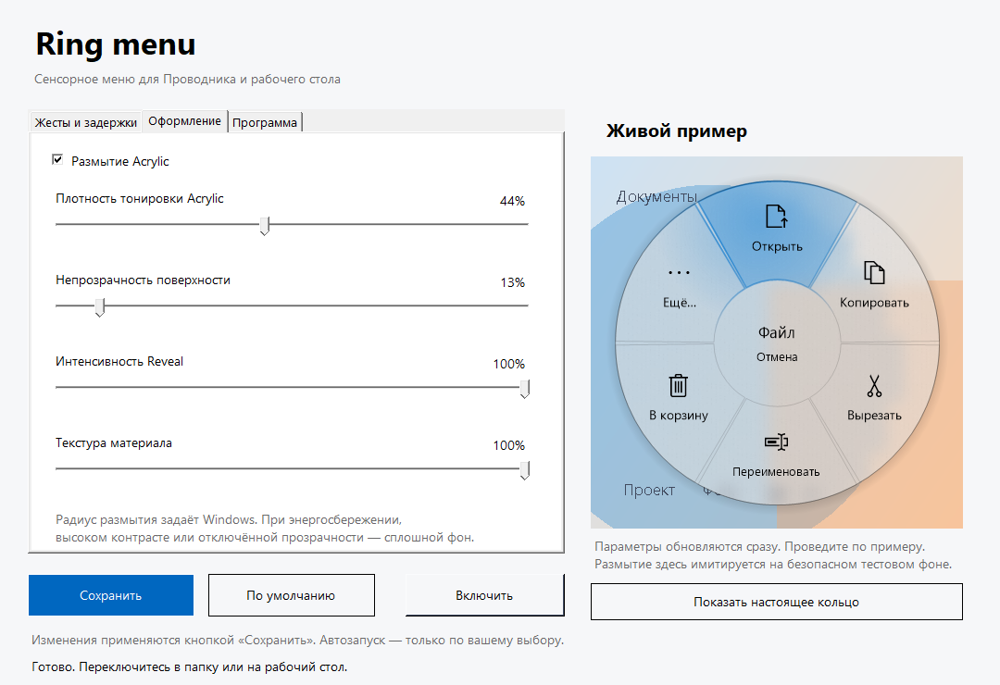
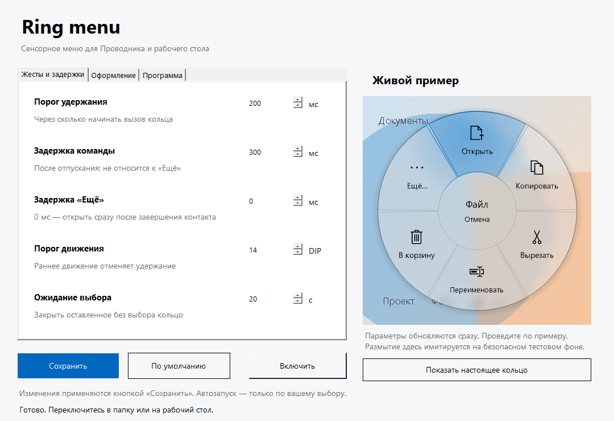
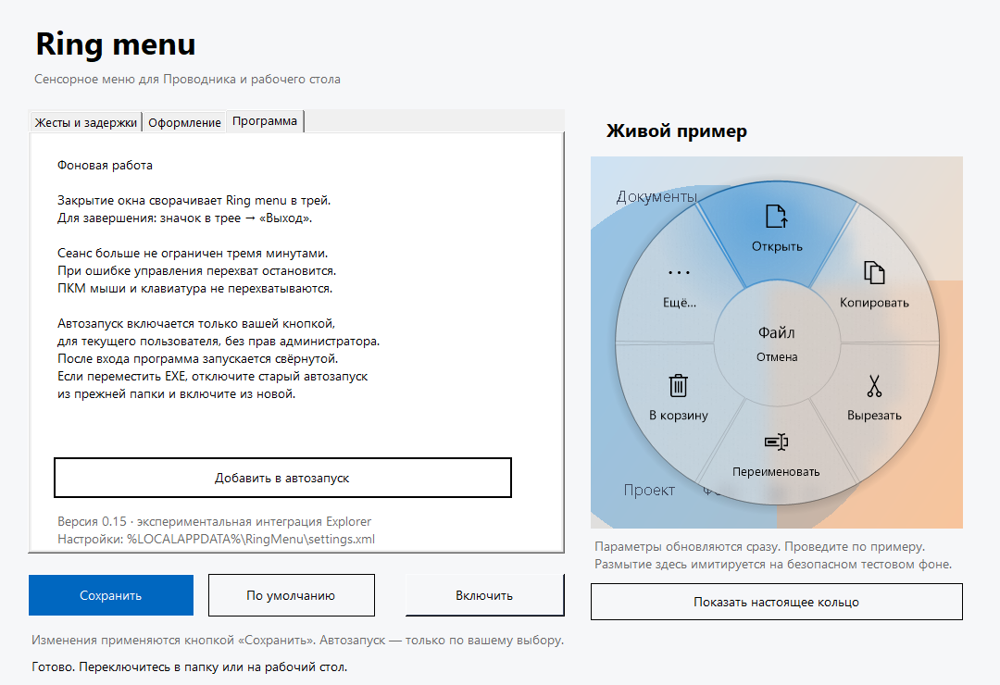
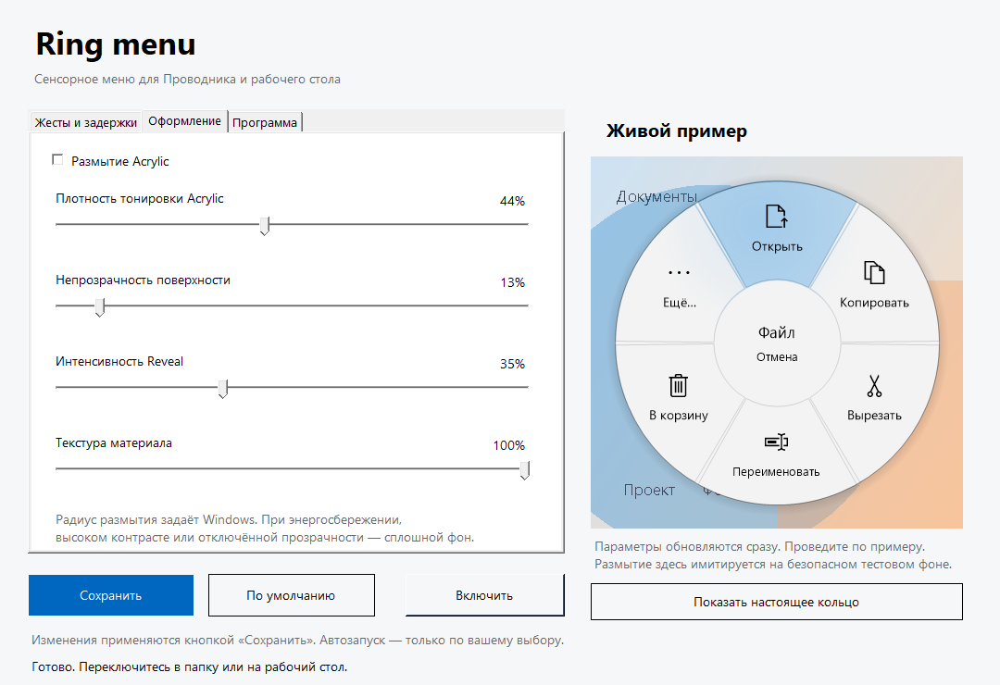

# Ring menu

Экспериментальное радиальное меню для сенсорного **Windows 10 x64**: удержание файла в Проводнике → кольцо → выбор действием пальца.

## Текущая сборка: 0.15 — настройки, живой пример и трей



### Настройки и фоновая работа

- **Жесты:** удержание 100–1500 мс (по умолчанию 200), задержки команды и «Ещё» 0–1000 мс, порог раннего движения 6–40 DIP, ожидание выбора 5–120 секунд.
- **Оформление:** включение Acrylic, плотность тонировки, непрозрачность поверхности, интенсивность Reveal и текстуры. Один общий белый/чёрный текст Segoe UI, без декоративных подложек и скруглений.
- Изменения оформления сразу видны в **живом примере**. Размытие в примере имитируется на синтетическом фоне; кнопка «Показать настоящее кольцо» показывает production renderer с DWM на 8 секунд, **без файловых команд**. Радиус размытия контролирует Windows, не фиктивный ползунок.
- «Сохранить» записывает `%LOCALAPPDATA%\RingMenu\settings.xml`. Новые параметры применяются между жестами, не меняют текущий контакт. «По умолчанию» изменяет черновик; требуется сохранение.
- Программа автоматически ждёт подходящее окно папки/рабочий стол. Закрытие настроек сворачивает её в **трей**. В трее: настройки, включение, пауза, выход. Общее трёхминутное отключение убрано; heartbeat, остановка при потере управления и ограничение захваченного контакта сохранены.
- **Автозапуск** включается/выключается только кнопкой пользователя. Используется значение `RingMenu` в `HKCU\Software\Microsoft\Windows\CurrentVersion\Run`, с кавычками вокруг пути EXE и `--background`. Администратор не нужен. При перемещении программы сначала отключите старую запись из прежней папки. Чужую запись с тем же именем программа не перезаписывает.
- Логи находятся в `%LOCALAPPDATA%\RingMenu\logs`; каждый журнал ограничен 10 MiB за запуск, после лимита прекращается диагностика, не обработка ввода. Старые журналы автоматически не удаляются.

<details><summary>Скриншоты настроек</summary>





Это снимки настоящего WinForms-интерфейса сборки Windows (`DrawToBitmap`), а не макеты. Пример использует тестовый фон и приближённое размытие: снимки не доказывают качество DWM Acrylic на рабочем столе. Личные окна, файлы и системный буфер не снимаются.

</details>

В папках Explorer и на рабочем столе кольцо различает файл и пустую область. Секторы вызывают настоящие действия, а не имитацию. Переименование использует штатный редактор имени Windows; имя вводит и подтверждает пользователь.

Это прототип, не готовое расширение оболочки. Работайте только с ненужными тестовыми файлами. Групповое переименование не поддерживается: проверяйте несколько файлов **по одному**.

### Команды

Пара сборки: `ExplorerRing-v015.exe` + `ExplorerBridge-v015.dll`. Новая native DLL обязательна: настройки жеста и возобновляемая фоновая сессия изменяют shared-memory ABI. Предыдущую версию нужно полностью закрыть через её окно/трей; смешивать версии нельзя.

- Файл: открыть, копировать, вырезать, переименовать, в корзину (с подтверждением), крупное «Ещё» с переходом к штатному меню.
- Пустое место: вставить, вставить ярлык, обновить, новая папка, свойства папки, «Ещё». Пункты «Вид», «Сортировка», «Создать» и расширения доступны в списке «Ещё», не отдельными кольцевыми подменю.
- Доступность вставки запрашивается у Windows Shell по текущему системному буферу. Работает не локальная память о последней кнопке. Если буфер изменён при открытом кольце, запрос вставки отменяется: откройте кольцо заново.
- Перед действием заново проверяются окно, папка и объект/пустое место под исходной точкой. Множественное выделение и виртуальные объекты пока не поддерживаются для файловых действий.
- Сенсорная работа версии 0.6 подтверждена пользователем на тестовом планшете. Это общее подтверждение, не отдельный протокол каждого пункта теста и не гарантия совместимости с другими устройствами.

### Оформление Windows 10

- **Один общий белый или чёрный цвет** для текста и значков всего кольца по средней линейной яркости области появления. Индивидуальных цветов секторов нет. Текст — Segoe UI Regular, alpha-safe сглаживание; значки — Segoe MDL2 Assets. Перед показом берётся один ограниченный образец области кольца; bitmap сразу освобождается, пиксели/цвета не сохраняются, не логируются и не передаются. Цвет фиксируется до закрытия; tint материала согласован с ним. При невозможности чтения фона — палитра темы. При высоком контрасте — системные цвета, без sampling.
- У текста и значков **нет декоративных подложек или скруглений** — только адаптивный чёрный/белый цвет поверх Acrylic. Недоступные команды остаются приглушёнными. На очень пёстром или изменившемся после показа фоне постоянный контраст не гарантируется.
- Отдельная поверхность под текстом: живое размытие DWM, тонировка и лёгкая текстура. На Windows 10 используется недокументированный `SetWindowCompositionAttribute`/AccentPolicy, поэтому совместимость не гарантируется. Для круга используется blur accent + собственные tint/grain вместо прямоугольного Acrylic accent; для списка — Acrylic accent. Принятие API не доказывает, что эффект визуально появился. Пиксели верхнего слоя передаются через top-down 32-bit DIB с сохранением premultiplied alpha, без `GetHbitmap`.
- Reveal — собственная отрисовка мягкого свечения и границ около **текущего касания**. Свет следует за пальцем, само кольцо остаётся неподвижным. Это не WinUI RevealBrush и не новая зависимость.
- При недоступном эффекте, отключённой прозрачности, энергосбережении, высоком контрасте или RDP используется сплошной фон. Высокий контраст также отключает декоративный Reveal. Настройки системы не изменяются.
- «Ещё» — компактный Acrylic-список: строки **32 DIP**, текст Segoe UI **13 DIP**, разделители **7 DIP**, внешние отступы **6 DIP**, ширина **320 DIP**. Монохромные пиктограммы Windows сопоставляются по canonical verb, не по локализованной подписи; неизвестным расширениям назначается нейтральный значок. Отдельных страниц нет: меню использует доступную высоту рабочей области, а при переполнении прокручивается свайпом или колесом мыши; справа — тонкий индикатор. Движение более 7 DIP отменяет выбор строки, свайп не выполняет команду. Никаких декоративных подложек и скруглений.
- Shell-меню создаётся **локально** из повторно проверенного файла либо папки (`GetUIObjectOf` / `CreateViewObject`), без передачи `IContextMenu` между процессами. Фон дополнен собственными пунктами «Вид» и «Сортировка» через документированные свойства живого `IShellFolderViewDual` (если интерфейс доступен). Это ограниченный набор видов/сортировок, не точная копия ПКМ. Остальные пункты, включая доступное «Создать», запрашиваются у Shell. Подменю заменяет список в том же окне; сверху — «Назад», снизу — переход к штатному меню. Высота подстраивается под содержимое, возврат восстанавливает позицию прокрутки. Касание снаружи закрывает без сквозного тапа, ожидание — до 30 секунд.
- Ленивые подменю инициализируются через `IContextMenu2/3`. Нестандартные owner-drawn/неинициализированные пункты и недоступный view context ведут в штатное меню без попытки угадать команду. Это не обещание точного визуального копирования всех расширений Explorer. Известное удаление направляется в корзину с подтверждением; неизвестные/прочие команды расширений требуют отдельного подтверждения. Текст меню обрабатывается в памяти, не логируется.
- Масштаб обычной ПКМ и системные настройки меню не изменяются. Во время списка перехват приостановлен; для штатного menu loop состояние дополнительно проверяется через `GetGUIThreadInfo`.

### Взаимодействие

- Если кольцо помещается вокруг пальца: удержание → движение в сектор → отпускание выполняет выбор. По умолчанию 200 мс/14 DIP, значения настраиваются. Порог срабатывает на ближайшем pointer update; запрос контекста Shell может добавить задержку. Раннее движение отменяет кандидата удержания. Отпускание в центре или за кольцом отменяет.
- У края: кольцо целиком размещается рядом, вне зоны пальца; исходное отпускание игнорируется. Следующее касание сектора выбирает действие; касание снаружи закрывает меню без сквозного тапа.
- Кольцо не вращается и не следует за пальцем. Учитываются рабочая область экрана и DPI.

### Запуск теста

1. Закройте предыдущие Ring Lab / Explorer Probe / Explorer Ring.
2. Поместите `ExplorerRing-v015.exe` и `ExplorerBridge-v015.dll` в одну папку. Предыдущую программу нужно полностью закрыть, не только остановить перехват. Native DLL также изменена; смешивать версии нельзя.
3. Запустите EXE в обычном сеансе Windows, **не от администратора**.
4. Переключитесь в папку Explorer либо на рабочий стол: подключение автоматическое. После паузы нажмите «Включить» в настройках или трее.
5. Удержите тестовый файл и выберите «Копировать». В другой папке удержите пустое место и выберите «Вставить». Повторите с вырезанием, с рабочим столом и с копированием обычной мышью. Проверьте остальные действия, включая файл у края экрана.
6. При переключении на другое подходящее окно программа автоматически переподключает временный перехват. Дайте ей секунду после переключения.
7. Закрытие окна оставляет программу в трее, «Выход» завершает её. Ожидание выбора кольца по умолчанию 20 секунд, длительность фоновой работы не ограничена. При ошибке управления безопасная остановка требует ручного включения.
8. Для проверки «Ещё»: на пустом месте откройте «Вид», «Сортировка» и «Создать»; смените вид и создайте одноразовую папку. На тестовом файле откройте «Отправить», если он доступен, без отправки личных данных; проверьте «Свойства». Повторите в папке и на рабочем столе, в том числе у края. После закрытия штатного меню кольцо должно снова вызываться.
9. Вызовите кольцо на светлом, тёмном и пёстром фоне, а также у границы окна/обоев: весь текст и значки должны иметь один общий белый/чёрный цвет, не меняться от движения пальца. Проверьте компактность, значки и Segoe UI в «Ещё»; длинный список прокрутите свайпом до последней команды без случайного выполнения. Проверьте подменю и возврат. Кнопка «Штатное меню…» намеренно возвращает исходное оформление Windows.

Пустое место не запускает файловые команды: вместо них показываются действия папки. Виртуальные элементы, неоднозначные имена, множественное выделение при работе с файлом и изменившаяся цель приводят к отказу. При отказе не используется F2 и не берётся случайный выделенный файл. Проверка UI Automation и Shell — экспериментальная, её совместимость с реальным Explorer ещё проверяется.

## Ограничения и безопасность

- Временно загружает небольшую native DLL в выбранный поток Explorer через thread-specific Windows hooks. Нет регистрации shell extension, установки драйверов или перезапуска Explorer. Единственное изменение автозапуска — opt-in запись HKCU по кнопке пользователя; при обычном запуске реестр не изменяется.
- Синтетическое уведомление `WM_POINTERCAPTURECHANGED` при перехвате — **экспериментальная гипотеза очистки жеста**, не передача системного capture. Геометрия/управление проверены на физическом планшете, но это не гарантия для других устройств.
- Физическая ПКМ, клавиатурные меню и перо намеренно не перехватываются. **При уже открытом смещённом кольце** защитная прозрачная подложка также занимает область мыши: смешанное mouse/touch-взаимодействие пока не решено.
- Штатный квадрат индикации удержания Windows остаётся.
- Имена/пути обрабатываются в памяти для проверки цели, но не записываются в журналы. Локальные журналы содержат время, координаты, классы окон и метаданные ввода; в Git они исключены.
- Нет обещания, что запрос редактора означает успешное переименование: результат подтверждает пользователь в Windows.
- «В корзину» использует `IFileOperation` с флагами recycle/undo и предупреждением при невозможности переработки. Если Windows предлагает безвозвратное удаление, отмените его. В кольце нет отдельного действия «Удалить навсегда».

## Сборка

Native DLL на Linux: Clang, `lld-link`, `llvm-dlltool`, `llvm-readobj`:

```sh
bash diagnostics/build-observer.sh
```

Скрипт использует `/tmp/opencode` для временной сборки; создайте этот каталог заранее, если его нет. Windows SDK и сторонние бинарные зависимости для DLL не нужны.

Windows UI: штатный .NET Framework 4.x x64 compiler, WinForms, WPF UI Automation assemblies:

```powershell
powershell -NoProfile -ExecutionPolicy Bypass -File .\diagnostics\build-ExplorerRing.ps1
```

Скопируйте DLL рядом с собранным EXE. Для переносимого ZIP используйте `diagnostics/Package-Release.ps1`: архив содержит только EXE, DLL и инструкцию. Подробности диагностических инструментов и тестов: [diagnostics/README.md](diagnostics/README.md).

## Статус

- 0.15: настройки жестов/задержек и материала, живой пример без файловых команд, трей с pause/resume/exit, автоматическое ожидание Explorer, opt-in автозапуск и отсутствие общего трёхминутного лимита. Native heartbeat продлевает bounded lease; пороги фиксируются при DOWN, внешность — при открытии кольца. Настройки атомарно сохраняются через XML, без сторонних зависимостей. Новые UI/background/autostart сценарии требуют отдельной ручной проверки; прежнее подтверждение 0.14 их не покрывает.
- 0.1: изолированный Ring Lab и первый временный перехват Explorer.
- 0.2: исправлено пересоздание области файлов при навигации; пользователь подтвердил взаимодействие, в том числе по углам.
- 0.3: добавлены проверка файла, запрос штатного переименования и переключение между папками/рабочим столом. Автотесты не заменяют интерактивную проверку этого нового функционала.
- 0.4: исправлено зависание кандидата удержания после обычного desktop drag, когда Windows присылает завершённый `WM_POINTERLEAVE` без `WM_POINTERUP`. Следующий primary down также восстанавливает незахваченный кандидат при потерянном завершении. Уход указателя с ещё прижатым пальцем не считается отпусканием; потеря захваченного контакта отменяет действие, а не выполняет его. Добавлен replay/regression test; повторная проверка на планшете ещё требуется.
- 0.5: в тесте 0.4 сессия остановилась защитой после потери одного события через примерно 37 секунд, не по таймеру. Разделены потери диагностики и управления, зарезервированы места для управления, ограничена частота MOVE и объединяются соседние MOVE одного контакта. Исходная позиция UP передаётся без ограничения частоты. Убрана построчная запись непрерывных движений на диск. Потеря события управления по-прежнему останавливает эксперимент; причина теперь явно отображается. Лимит остаётся 3 минуты с подключения.
- 0.6: контексты файла/пустой области, настоящие команды Shell, недоступные серые сектора, проверка изменения буфера обмена, «Ещё» с запросом штатного меню Explorer. Изолированный тест подтвердил содержимое после copy/paste и cut/paste без изменения интерактивного буфера обмена. 20 октября 2026 пользователь подтвердил работу версии на физическом планшете.
- 0.7: выбранный пользователем порог 450 мс, Fluent Acrylic/Reveal с безопасным сплошным fallback, компактная per-pixel-alpha поверхность вместо magenta color key, значки и тема Windows. Диагностика native popup/submenu и пауза новых захватов во время menu loop; проверки упаковки отрицательных экранных координат и отказ зарезервированной точки клавиатурного меню. Нужна ручная визуальная/сенсорная проверка.
- 0.8: после сообщения о прямоугольнике/непрозрачности заменена передача alpha bitmap на прямое копирование PArgb в DIB, отключена непрозрачная фоновая отрисовка и прямоугольное расширение glass. Для круга используется custom Acrylic на blur accent. «Ещё» получает собственный крупный список из живого view context menu, lazy submenus, страницы и native fallback. Проверки байтов alpha и скрытой отрисовки не доказывают визуальное исправление на физическом экране.
- 0.9: пользователь видит Acrylic, но текст теряется на фоне; добавлены независимая оценка яркости под каждым сектором/центром, чёрные/белые надписи/значки и контрастные подложки. Воспроизведён отказ live `IContextMenu` с `0x80040155`; меню теперь создаётся в локальном STA, а ограниченные View/Sort-команды добавляются через automation. Ошибка получения меню больше не замалчивается: журнал содержит тип/HRESULT без текста исключения. Тесты не заменяют проверку реальных View/Sort/создания на планшете.
- 0.9.1: по требованию пользователя удалены подложки/скругления текста и значков кольца и дополнительная текстовая подложка «Ещё». Адаптивный цвет, Acrylic, геометрия и команды не изменены.
- 0.10: после подтверждения работы «Ещё» пользователь запросил единый цвет кольца и более компактный вид. Один общий black/white foreground, Segoe UI с alpha-safe сглаживанием и увеличенными подписями кольца; монохромные MDL2-значки в списке, строки 32 DIP, короткие разделители, без страниц, swipe/wheel scroll с отменой команды при движении. Автотесты проверяют swipe без выбора, границы прокрутки, достижимость последнего элемента, подменю/возврат и наличие Segoe UI; внешний вид/физический свайп требуют проверки.
- 0.11: постоянный DIB/DC и прямая отрисовка в него вместо выделения/копирования bitmap каждый кадр; фон/текст кольца кэшируются до закрытия, повторный неподвижный кадр пропускается. Смежные MOVE отображаются по последней позиции без перехода через UP/cancel. Poll interval 10 мс вместо 20 (не гарантия частоты Windows timer), native MOVE остаётся ограничен 16 мс. Для «Ещё» убрано искусственное ожидание 300 мс; прочие действия сохраняют задержку. Canonical verbs запрашиваются по необходимости с кэшем, root menu не инициализируется повторно; lazy submenu — при раскрытии. Проверки цели и буфера сохранены. Изолированный замер на планшете: средний кадр 34.06 → 8.45 мс (30 кадров, скрытое окно, не end-to-end touch latency). Shell-расширения всё ещё могут задерживать синхронный запрос; `MORE_TIMING` показывает этапы без содержимого меню.

- 0.12: кэш Reveal-заливки/геометрии и общий border gradient; coalesced async wake вместо ожидания UI timer; убран грубый 16-мс MOVE throttle (queue coalescing, точный UP и защита потерь сохранены). Таймер остаётся резервом. Усреднение яркости читает строки и таблицу linear-light без GetPixel/pow; общий чёрный/белый цвет не меняет правило. «Ещё» просыпается по вводу вместо Sleep(10), но Shell extensions остаются синхронны. На том же планшете, 60 скрытых кадров: 0.11 mean 8.54 / p95 9.64 мс, 0.12 mean 5.78 / p95 7.29 мс. Synthetic contrast: 9.02 → 0.13 мс. Это не end-to-end latency; cold-start rendering прогревается на скрытой собственной поверхности до подключения. Повторное открытие остаётся около 35 мс, Shell query не показал достоверного ускорения. Native wake/rearm/partial drain, геометрия/Reveal cache и изолированный copy/cut/paste пройдены; нужен физический тест очереди без 16-мс ограничителя.

- 0.13: удержание 300 мс (тест границы 299/300), прежний slop/short-tap/drag guard. Файловый Shell-контекст, уже построенный для доступности секторов, сохраняется только до конца текущего жеста в том же STA; «Ещё» не строит его второй раз при неизменном clipboard sequence. После проверки цели повторно используется также точный Shell item, а не второй обход папки. При отмене/остановке/ошибке/завершении контекст освобождается; при изменении буфера меню запрашивается заново. Фоновое меню отличается от меню объекта папки и не переиспользуется: там ускорение меньше. Self-test проверяет ownership, single-use, disposal и clipboard invalidation без записи пользовательского буфера. В изолированном тесте build ~51–56 мс, reuse после прогрева ~0.01 мс (первый вызов ~3 мс); это не полная задержка открытия «Ещё». UIA/Validate/SelectItem/Shell extensions и отрисовка сохраняются.

- 0.14: только дальнейшее сокращение hold threshold до 200 мс (native/standalone/progress) и версии сборки. Тест границы 199/200 мс; сохранены ранний drag, отмена, восстановление контакта и проверки файлов. 200 мс — порог кандидата, не гарантия появления готового кольца ровно за это время. Физические short tap/drag и отсутствие ложных вызовов требуют проверки.

Вдохновение/исследования: [Surface Dial](https://youtu.be/QpUztkV1jI0?t=76), [Filee](https://github.com/KnifeLemon/Filee), [Nilesoft Shell](https://github.com/moudey/Shell). Их исходники и бинарники в проект не включены; Nilesoft не требуется для запуска.
